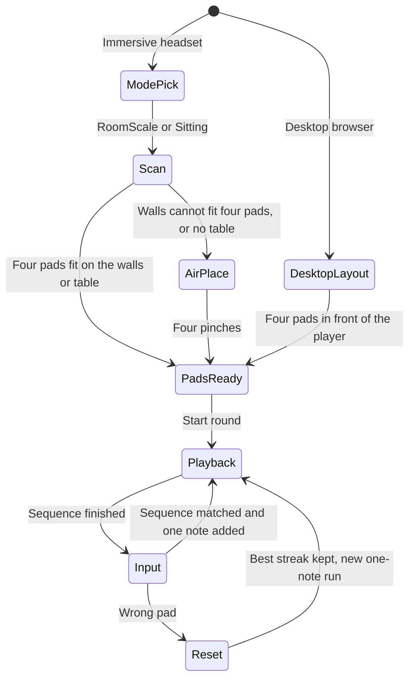

# Wall Tones handoff plan

Implementation spec for a later agent. The menu already has a Wall Tones entry. This document defines the game. Do not treat colors, tones, or spoken lines here as final until the original Unity project is reviewed.

Track progress in [WALL_TONES_TODO.md](WALL_TONES_TODO.md). Update that file as each item starts and finishes. Add a short note when an item is blocked. Do not leave it stale at the end of a session.

## What already exists

PR #4 added a hub, not the game. [src/app-mode.ts](src/app-mode.ts) defines `ExperienceMode` including `'walltones'`. Choosing **Wall Tones (planned)** shows scene node `wall-tones-panel` ([public/ui/wall-tones-placeholder.uikitml](public/ui/wall-tones-placeholder.uikitml)) and hides the menu. **Back to main menu** (`back-to-menu-button`) returns to `'menu'`. Mode changes emit `experience-mode-changed`.

Leave that switch alone. Replace the placeholder copy and add Wall Tones systems that run only while the mode is `walltones`. Keep the back button id.

The project is still one VR world: [iwsdk.config.json](iwsdk.config.json) has `xr.mode: "vr"`, hand tracking, gaze, locomotion, and `sceneUnderstanding: false`. Demo and meditation depend on that. Do not flip the whole app to AR.

## Product

Continuation of [Wall Tones](https://www.meta.com/experiences/wall-tones/7404410872921189/) (Corbomite Games): a mixed-reality Simon game on the player's real room. Four colored pads, each with its own tone. The game plays a growing sequence; the player repeats it by touching the pads. Score is the highest streak, meaning the longest sequence completed without a miss.

Locked rules:

- A wrong touch resets the current sequence and starts a new run at one note. The best streak stays.
- Gameplay input is hands only. A controller poke does not count. Touch means the index fingertip enters the pad volume.
- Room scale does not need four separate walls. Prefer one pad per wall, and put more than one 1 m pad on the same wall when that is what fits. Air placement starts only when the vertical surfaces cannot hold four non-overlapping pads. That path is the same one sitting mode uses when it finds no table.
- On desktop, outside an immersive session, skip mode choice, scanning, and air placement. The four pads appear in a fixed layout in front of the player and the round starts.

## Flow

1. On a headset, inside Wall Tones, the player picks **Room scale** or **Sitting**, then enters a passthrough session. On desktop, skip this and step 2 through 5.
2. Voice explains that the headset is looking at the room. Wait a few seconds for planes. If none appear, offer Quest room capture (`initiateRoomCapture` when the session exposes it), then look again.
3. **Room scale.** Collect vertical planes that face into the room. Place four 1 by 1 meter pads on those planes. Prefer a different wall for each pad. When fewer than four walls are usable, put more than one pad on the same wall, with a gap of about 0.25 m so one hand does not cover two pads. Keep each square fully on its plane, around chest-to-head height, and anchor it. If the walls together cannot hold all four without overlap, place none of them. Voice tells the player there is not enough wall space and to place four buttons in the air beside them.
4. **Sitting.** Prefer one horizontal plane that is a table: clearly above the floor, large enough for four pads with gaps. Lay the pads out in a 2 by 2 grid on that surface and anchor them. If no table qualifies, use the same air-placement voice and steps.
5. **Air placement.** Four steps. A ghost pad sits about 0.35 m in front of the tracked hand. A pinch drops it. Voice counts "1 of 4" through "4 of 4". Pinch is placement only; during the game, pinch does not press a pad.
6. **Desktop.** When Wall Tones is open and the session is not immersive, spawn all four pads immediately in a 2 by 2 grid facing the camera, centered in front of the player so every pad sits inside the default desktop frame. Use about 0.45 m squares with a clear gap. There is no scan, no room capture, and no pinch placement. A pointer or ray click is the desktop stand-in for a fingertip touch, because no hand is tracked. Entering XR from this mode removes that layout and starts the headset setup.
7. Voice says the game is starting. Playback lights each pad and plays its tone. Input is ignored during playback.
8. The player repeats the sequence. On a headset, a fingertip entering the thick box counts once; the finger must leave before that pad can count again. On desktop, a click counts once until the pointer leaves the pad. The correct pad flashes and plays its tone.
9. A completed sequence increases the streak, updates the best streak when beaten, appends one random color (repeats allowed), and plays the new sequence.
10. A wrong pad plays a short error tone, voice says to start again, clears the sequence, and after a short beat plays a new one-note sequence. Best streak is unchanged.
11. Back to the menu stops speech, removes pads, and clears the streak for the next visit.

## Pads, color, and sound

Each pad is a 1 m by 1 m colored square parented to an anchor. The touch volume is an oriented box of the same width and height and about 0.2 m thick, sticking out from the wall or table toward the player so the hand counts before it would pass through the real surface. Do not turn on the global physics feature for this. `physics` is off for the hub, and a physics world would affect demo and meditation. Test the index fingertip against that box directly.

Provisional palette and sine tones, until the Unity project is reviewed: green 392 Hz, red 330 Hz, blue 494 Hz, yellow 587 Hz. Note length about 0.45 s, gap about 0.15 s. These numbers are placeholders, not a claim about the shipped game.

The in-mode panel shows the best streak and whether the game is showing the sequence or waiting for a touch.

## Voice

Use the browser `speechSynthesis` API in English. Cancel any utterance when leaving the mode or starting a new line. Ship a small line list in code for: choose a mode, look around the room, room capture, pads placed on the walls, not enough wall space so place buttons in the air, table found, no table so place buttons in the air, pinch to place each button, desktop pads ready, game start, round success, wrong touch / start again, and back to menu. Desktop may speak the short ready line and then start; it does not speak the room-scan lines.

The original Unity project used VoiceSDK. This web app uses browser speech until that project is reviewed. Do not copy VoiceSDK, recorded clips, or art from the Unity project into this repo during that review until the replacement values are chosen and written back into this document.

## Session boundary

Plane detection on Quest requires an `immersive-ar` session with plane detection, anchors, and hand tracking. This app's config launches `immersive-vr` for the studio, demo, and meditation. One session cannot be both.

Implementation approach: on entering a Wall Tones scan, dispose or leave the VR world and create an AR world with `sceneUnderstanding`, plane detection, anchors, and hand tracking, transparent clear, and no locomotion. Returning to the menu recreates the VR world and restores `'menu'`. Do not set [iwsdk.config.json](iwsdk.config.json) `xr.mode` to `ar`. If a later IWSDK API can retarget `launchXR` without rebuilding the world, use that instead of a double create, with the same feature set.

Desktop does not scan for planes. Verify the front grid, pointer clicks, sequence logic, wrong-touch reset, and best streak there. Prove planes, anchors, air placement, and fingertip hits on a Quest passthrough session. The repo emulator default is `metaVRGlasses` for the meditation feature; Wall Tones checks should use a Quest-sized view, without changing that default.

## Files to touch

- [public/ui/wall-tones-placeholder.uikitml](public/ui/wall-tones-placeholder.uikitml): mode choice, streak, status. Keep `back-to-menu-button`.
- New `src/wall-tones/` modules for setup, pad volumes, sequence state, and speech. Register their systems from [src/index.ts](src/index.ts).
- [src/assets.ts](src/assets.ts) only if a new manifest entry is required. Pads can be runtime objects.
- Do not edit the menu button wiring in [src/app-mode.ts](src/app-mode.ts) except to listen for `walltones`.

## Pending Unity project review

The owner will later give an agent the original Unity project. That pass replaces placeholders only. Check and then update this doc:

- tone frequencies, waveforms, and timing
- spoken script and whether lines were recorded clips
- pad colors and the original wall-art look
- whether a repeated color in one sequence was allowed
- how the Unity build picked walls and the table, including any scene-model API

## Acceptance

- From the hub, Wall Tones opens its own setup and Back returns to the menu without leaving meditation or demo broken.
- On desktop, four pads appear in front of the player with no scan, and a click plays a note.
- On a headset, room scale places four 1 m pads on the available walls, preferring a separate wall for each, and shares a wall when it must. If four pads will not fit, voice leads into four air pinches. Sitting places four pads on a table, or uses that same air path when no table is found.
- Only an index fingertip scores a hit.
- Sequences grow by one after each success. A miss resets the current run to one note and leaves the best streak visible.
- Speech cancels on exit. Typecheck and production build pass.
