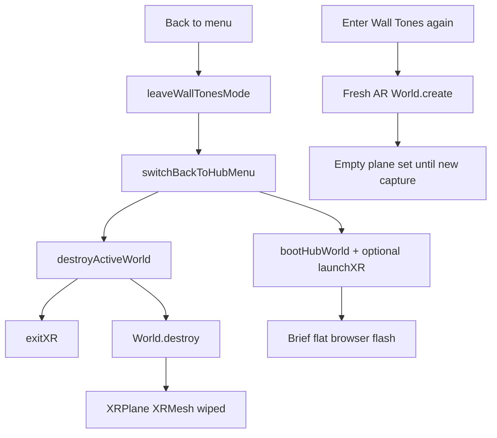

# Wall Tones code review — 2026-11-12

Read-only review of `main` at `dded1b7` (after PRs #63, #64, #65, #68, #70). Use this file to hand work to separate agents. Keep each agent on **one** work package below. Do not fold unrelated fixes into the same PR.

Owner backlog items live in [`WALL_TONES_TODO.md`](../WALL_TONES_TODO.md). Agent task tracking lives in [`todo.md`](../todo.md). Follow [`AGENTS.md`](../AGENTS.md) and invoke `iwsdk-dev` before implementation.

---

## Verdict

Prior Wave-1 product mismatches are largely **fixed in code**. The highest remaining product risk is **backlog #58** (Back to menu tears down XR and the AR world, then scan/plane data is gone). Hygiene traps (`panel.ts` importing `three`, gaze debug flags) are still open. Maintainability risk grew: `src/wall-tones/wall-tones-system.ts` is ~4497 lines.

---

## Fixed since the previous review

| Finding | Status | Evidence |
|---|---|---|
| Fanfare vs air-place colors (#50) | Fixed in code (keep fanfare GRYB; air place matches) | `SIMON_FANFARE_PAD_ORDER = [0,1,3,2]`; air ghost uses that order; unit tests `pad-order` / `air-pad-runtime`. PR #68 merged. Headset acceptance may still be open. |
| MR pads not ray-targetable | Fixed | Play pads use `rayInteractable: true`; PR #65 (`readRayAndGazeTouches`). Quest validation still pending. |
| Game Over / streak savers (#63) | Merged | Desktop e2e coverage present. |
| Cypher Act 1 starter (#64 / #70) | On main | Progress + radio windows live. |

---

## Still open (from previous review)

| Finding | Severity | Notes |
|---|---|---|
| `src/panel.ts` imports from `'three'` | Med | Only production `src` offender; must import from `@iwsdk/core`. |
| Gaze `logDiagnostics` / `showDebugReticle` true in `iwsdk.config.json` | Med | Ships debug reticle/noise unless gated. |
| `new Vector3(0,1,0)` in setup/panel follow in `wall-tones-system.ts` | Low–Med | `panel.ts` already reuses `menuUp`; system still allocates (~1042, ~1126, ~3193). |
| `RobotSystem` subscribe without `cleanupFuncs` | Low | Hub demo only. |
| `bar-floats` `scene.add` | Low | Overlay FX bypasses ECS. |
| God system + circular `world-host` import | High maintain / Low cycle | Cycle mitigated by dynamic import in `app-mode`. |
| Headset bugs #3, #4, #20, #41 | Open | Need device evidence. |

---

## New high finding: #58 menu / XR / scan loss

**Symptom (owner):** Game → main menu drops out of XR for a few seconds; returning loses scene data; rescan does not reload it.

**Root cause (code):**

1. `onBackToMenu` in `src/wall-tones/wall-tones-system.ts` → `leaveWallTonesMode()` clears pads / setup state.
2. AR path calls `switchBackToHubMenu({ reenterXr })` in `src/wall-tones/world-host.ts`.
3. `destroyActiveWorld()` does `exitXR()` then `world.destroy()` — all ECS `XRPlane` / `XRMesh` entities die.
4. Hub world boots; optional `launchXR()` explains the brief flat flash.
5. Re-enter boots a fresh AR world with empty plane queries; choose-mode rescan only calls `initiateRoomCapture()` and may not recover like a full scanning phase.

**Preferred direction:** Keep a single AR world and swap UI mode (hide game, show menu) — no `World.destroy` on in-session Back to menu.

**Fallback:** Destroy is acceptable only if re-entry forces full `scanning` + capture and setup restore; document that scan cannot survive a world swap.

---

## What is still solid

- Desktop e2e + units remain the CI backbone; Game Over paths have desktop coverage.
- No `entity.destroy()`, no Vec `setValue` abuse, no scene JSON `imports`.
- Dual-world host is explicit; pad ray volumes are separate from touch volumes (PR #65).
- Pure helpers (placement, economy math, pad order) stay unit-tested.

---

## Agent work packages

Launch **one agent per package**. Each package is one focused PR unless noted.

### Package A — backlog #58 (first / highest priority)

**Goal:** Stop immersive Back to menu from dropping XR and wiping room scan data.

**Scope:** `src/wall-tones/world-host.ts`, `src/wall-tones/wall-tones-system.ts` (`onBackToMenu` / `leaveWallTonesMode`), related `app-mode.ts` enter/leave paths, rescan/scanning flow.

**Out of scope:** Store skill tree, hygiene imports, monolith split, Cypher story content.

**Acceptance:**

- From an MR Wall Tones session, Back to menu does not briefly dump the player to the browser flat view (or documents an unavoidable UA limitation with a mitigation).
- Returning to the game does not permanently lose plane/mesh scan; rescan works or a full re-scan path is automatic and reliable.
- Flat/desktop Back to menu still works.
- `npm run --if-present typecheck`, relevant unit tests, and `npm run test:e2e` green before PR.
- Headset check called out separately if not run.

### Package B — hygiene PR

- `panel.ts`: `'three'` → `@iwsdk/core`
- Gaze debug flags off (or DEV-only) in `iwsdk.config.json`
- Hoist up-vector temps in `wall-tones-system` panel follow
- `RobotSystem` `cleanupFuncs`
- Sync stale merge notes in `WALL_TONES_TODO.md` for #50 / #63 / #65 / #68

### Package C — headset regression pass

Reproduce and file/fix with evidence: blink/arrow (#3), startup menu ray (#4 / #47), boundary (#20), achievement VO listen (#41), post-#65/#68 pad ray + fanfare colors on Quest.

### Package D — open product PRs (owner priority, one at a time)

- PR #69 skill-tree store (MERGEABLE, large)
- Then research #72 / #74 / #75 and Cypher background #76

Do not start D until A is branched or owner says otherwise if they conflict on the same files.

### Package E — split monolith (after A / #69 settle)

Behavior-preserving split of `wall-tones-system.ts` (~4497 lines); reduce `world-host` circular coupling.

### Package F — audio/asset extraction

Move remaining embedded speech/art blobs to `public/` via `src/assets.ts` as Cypher/store clips grow.

---

## Out of scope until chosen from the backlog

Sports mode (#5), juice (#6), unfinished skill-tree decisions (#66–#70), Cypher Act 2, economy balancing spreadsheet.
