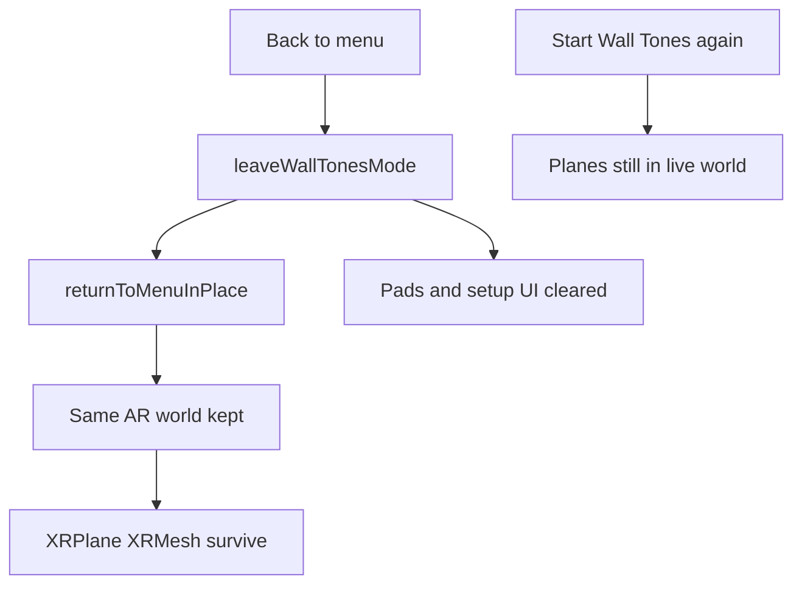

# Wall Tones code review — 2026-11-13

Re-review of `main` at `259c49b` after merges of PRs **#78** (#58), **#69/#79/#84** (skill-tree store), **#76/#85** (Cypher background), and related reconciles. Supersedes agent packaging in [`CODE_REVIEW_NOV12.md`](CODE_REVIEW_NOV12.md) for new handoffs; keep Nov 12 as historical context.

Owner backlog: [`WALL_TONES_TODO.md`](../WALL_TONES_TODO.md). Agent tasks: [`todo.md`](../todo.md). Follow [`AGENTS.md`](../AGENTS.md); invoke `iwsdk-dev` before implementation. **One agent per package; one focused PR.**

---

## Verdict

**#58 preferred fix is on main** (`returnToMenuInPlace` — no in-session `World.destroy`). Skill-tree store and Cypher background dialogue are also on main. Highest remaining risks are now **process drift** (`WALL_TONES_TODO.md` badly stale), **unfixed hygiene** (`panel.ts` → `three`, gaze debug on), **headset-unverified bugs** (#3, #4, #20, #58 immersive confirm), and a **larger god system** (~5275 lines in `wall-tones-system.ts`, up from ~4497).

---

## Fixed since Nov 12 review

| Finding | Status | Evidence |
|---|---|---|
| Package A / backlog #58 | **Fixed in code** (preferred path) | `onBackToMenu` → `returnToMenuInPlace()`; policy `back-to-menu-policy.ts` always returns false for destroy; unit `tests/unit/back-to-menu-world.test.mjs`. PR **#78** merged. **Headset verify still required.** Backlog checkbox still `[ ]` / “in progress” (docs lag; PR **#82** open+conflicting). |
| Skill-tree store (#44 / #69) | **On main** | PRs **#69**, **#79**, **#84** merged. |
| Cypher background lines (#62 / #76) | **On main** | PR **#76** (+ **#85**). Clips under `public/audio/story/cypher/`. |
| Prior #50 / #63 / #65 / #68 | Still on main | Unchanged. |

---

## Still open

| Finding | Severity | Notes |
|---|---|---|
| `src/panel.ts` imports from `'three'` | Med | Only production `src` offender; use `@iwsdk/core`. |
| Gaze `logDiagnostics` / `showDebugReticle` true | Med | `iwsdk.config.json`. |
| `new Vector3(0,1,0)` in panel-follow paths | Low–Med | Still in `wall-tones-system.ts` (~1084, ~1168, ~3325, ~3654). |
| `RobotSystem` missing `cleanupFuncs` | Low | `src/robot.ts`. |
| `bar-floats` `scene.add` | Low | Overlay FX. |
| God system size | **High maintain** | ~**5275** lines; store + Cypher grew the monolith; no split. |
| #3 blink/arrow in VR | High product | Still open; needs headset. |
| #4 startup menu ray | Med | Still open; headset. |
| #20 boundary | Low–Med | Still `[~]`. |
| #41 achievement VO listen | Code done / device open | Implemented; MR/iPhone listen pending. |
| #58 headset confirmation | Med | Code merged; immersive accept not recorded. |
| `WALL_TONES_TODO.md` drift | **Med process** | Claims #58 in progress, #69/#68/#70 not merged, store still “open” — false vs `main`. |

**IWSDK trap scan:** no `entity.destroy`; no Vec `setValue` abuse; no scene JSON `imports`; only `'three'` import is `panel.ts`.

---

## New findings

| Finding | Severity | Notes |
|---|---|---|
| Monolith grew ~800+ LOC after store + Cypher | High maintain | Helpers exist, but UI/story still concentrated in one system. |
| #58 test gap | Med | Policy/unit only; no e2e proving XR session + plane queries survive Back→menu→Start. |
| `switchBackToHubMenu` unused by Back path | Low | Escape hatch remains; easy to reintroduce the bug if called again from menu. |
| Back button double-bound | Low | AppMode `setMode('menu')` + system `onBackToMenu` — redundant, currently safe. |
| Open product PRs conflict risk | Info | **#87** Play/Index/control row — OPEN, **CONFLICTING**, +631. **#88** achievement celebration — OPEN, MERGEABLE, +1465. |
| Research/lab drafts not on main | Info | #72 movement, #74 nod, #75 thumbs; drafts #90–92 lab menu / rift / armband — no main risk until merge. |
| ~1.4 MB embedded speech/art TS blobs | Med maintain | Cypher new audio correctly in `public/`; achv-intro / new-best / pick-combined still embedded. |

---

## What is still solid

- #58 in-session path no longer destroys the AR world.
- Desktop e2e + units remain the CI backbone; store and Cypher have additional coverage.
- Dual-world host is clearer with an explicit in-place menu API.
- Pad ray vs touch volume split (PR #65) still in place.

---

## Agent work packages (Nov 13)

### Package 1 — backlog / docs sync (do first; unblocks truthful handoffs)

Update [`WALL_TONES_TODO.md`](../WALL_TONES_TODO.md) (and [`todo.md`](../todo.md) if needed) to match `main`:

- Mark **#58** done in code with **headset verify pending** (or land/redo conflicting PR **#82**).
- Mark skill-tree store / #69/#79/#84 and Cypher background / #76 as merged where appropriate; fix stale “not merged” notes for #50/#68/#70/#12/#44.
- Land or close conflicting docs PR **#86** if still relevant.

No gameplay code in this package.

### Package 2 — hygiene (former Nov 12 Package B)

- `panel.ts`: `'three'` → `@iwsdk/core`
- Gaze debug flags off or DEV-only
- Hoist up-vector temps in `wall-tones-system` panel follow
- `RobotSystem` `cleanupFuncs`

### Package 3 — headset regression pass

With evidence on Quest (and iPhone where noted):

- #3 blink/arrow
- #4 / #47 menu ray + follow
- #20 boundary
- #41 VO listen
- **#58** immersive Back to menu (no XR dump; planes usable after return)
- Post-#65/#68 pad ray + fanfare colors

### Package 4 — open product PRs (owner priority, one at a time)

1. Rebase/fix **#87** (Play / Index / control row) — currently CONFLICTING.
2. Then **#88** celebration (MERGEABLE) if it does not fight #87 on the same files.
3. Research labs #72 / #74 / #75 only when owner asks; keep off the monolith hot path if possible.

### Package 5 — split monolith (after #87/#88 settle)

Behavior-preserving extract from `wall-tones-system.ts` (~5275 lines): store UI, Cypher runtime, setup/scan, gameplay input. Reduce accidental reuse of `switchBackToHubMenu` for in-session menu.

### Package 6 — audio/asset extraction

Move remaining embedded `achv-intro-*` / `new-best-*` / `pick-combined-*` / icon art blobs to `public/` via `src/assets.ts` (match Cypher’s public-audio pattern).

---

## Out of scope until chosen from backlog

Sports mode (#5), juice (#6), unfinished modifiers (#66–#70 beyond what #87 covers), Cypher Act 2, light patches (#61), economy spreadsheet, Store→Modifiers rename (#56) until owner picks timing.
