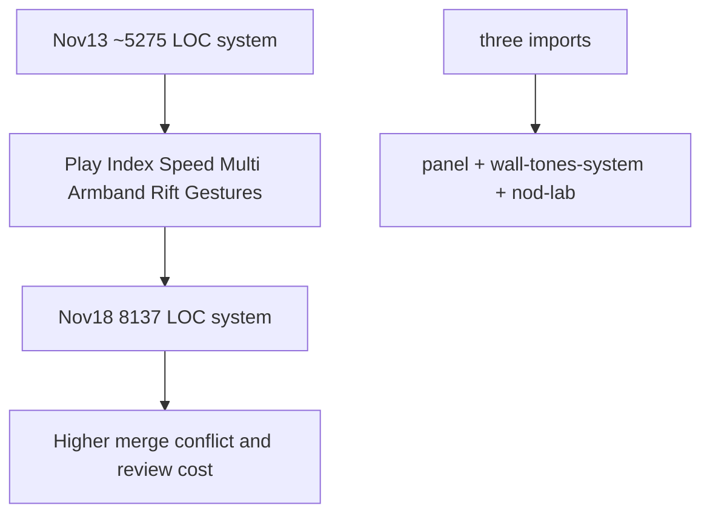

# Wall Tones code review — 2026-11-18

Re-review of `main` at `8cf45c42a730afdcd343b387566a0ef032d82cea` (`8cf45c4`). Supersedes agent packaging in [`CODE_REVIEW_NOV13.md`](CODE_REVIEW_NOV13.md) for new handoffs; keep Nov 12/13 docs as history.

Owner backlog: [`WALL_TONES_TODO.md`](../WALL_TONES_TODO.md). Agent tasks: [`todo.md`](../todo.md). Follow [`AGENTS.md`](../AGENTS.md); invoke `iwsdk-dev` before implementation. **One agent per package; one focused PR.**

**Release context:** Cloudflare production was promoted from an earlier main (`0d7e868` on CloudFlareProd). Live main is ahead (v0.1.1 build-date, PR #125 nod sensitivity, docs). Green CI alone is not headset acceptance.

---

## Verdict

A lot of product work landed since Nov 13 (Play/Index, celebration, Speed/Multiplier, armband/projector, Rift Lab visuals, thumbs/nod story hooks). **#58 in-place menu path is still intact.** Highest remaining risks are **maintainability** (`wall-tones-system.ts` grew to **8137** lines), **hygiene regression** (`from 'three'` now in **three** `src` files; gaze debug still on), and **headset-unverified** bugs (#3, #4, #20, #58 immersive). Docs/backlog sync from Nov 13 Package 1 is largely honest.

---

## Fixed since Nov 13 review

| Finding / package | Status | Evidence |
|---|---|---|
| Package 1 backlog/docs sync | **Mostly fixed** | #58, #44, #54, #66/#67/#69 marked Done with headset caveats where needed. Checkpoint SHA in TODO slightly lags HEAD. |
| Package 4 product PRs #87 / #88 | **Merged** | Play/Index/control row; achievement celebration. |
| Labs → partial story hooks | **On main** | Thumbs #137, nod #139; iPhone nod sensitivity #125. |
| Speed / Multiplier | **On main** | PRs #130 / #132. |
| Armband / palm projector / Rift visuals+SFX | **On main** | Including #150 3D buttons, #135 SFX, #129/#155 visual stack. |
| #58 preferred fix | **Still intact** | `onBackToMenu` → `returnToMenuInPlace()`; `back-to-menu-policy.ts`; unit `back-to-menu-world.test.mjs`. Headset verify still open. |
| Failure-path speech routing (#60a) | **Shipped** | PR #100; owner line-by-line review still open. |

---

## Still open from Nov 13

| Finding | Severity | Notes |
|---|---|---|
| Hygiene: `'three'` imports | **Med (worse)** | Was only `panel.ts`. Now also `wall-tones-system.ts` (`Euler`) and `nod-lab/nod-lab-system.ts` (`Euler`, `Quaternion`). All should use `@iwsdk/core`. |
| Gaze `logDiagnostics` / `showDebugReticle` | Med | Still `true` in `iwsdk.config.json`. |
| `new Vector3(0,1,0)` in hot panel-follow paths | Low–Med | Still allocating in `wall-tones-system.ts`. |
| `RobotSystem` without `cleanupFuncs` | Low | Unchanged. |
| `bar-floats` / more FX `scene.add` | Low | Overlay path; armband/celebration/rift also use raw scene adds. |
| God system / Package 5 split | **High maintain (worse)** | **8137** lines (was ~5275). Helpers extracted, orchestration still centralized. |
| Package 6 embedded audio | Med maintain | ~1.4 MB still in `achv-intro-*` / `new-best-*` / `pick-combined-*` TS modules. |
| Headset #3 blink/arrow | High product | Still `[ ]`. |
| Headset #4 menu ray | Med | Still `[ ]`. |
| #20 boundary confirm | Low–Med | Still `[~]`. |
| #41 / #58 device listen & immersive | Med | Code done; Quest/iPhone verify open. |

**IWSDK trap scan:** no `entity.destroy`; Transform uses `getVectorView`; no scene JSON `imports`.

---

## New findings (Nov 13 → 18)

| Finding | Severity | Notes |
|---|---|---|
| Monolith grew ~+2860 LOC despite helper modules | High maintain | Armband, gestures, Cypher, store UI still driven from one system. |
| `'three'` spread beyond hub panel | Med | Duplicate Three instance risk in gameplay + nod lab. |
| Open product queue changed | Info | **#153** Skip Voice story progress — OPEN, often conflicting. **#163** encouragement clips — DRAFT assets only. **#166** timing-fault reset — DRAFT, design-gated. Docs/research: **#165**, **#167**. |
| Production vs main divergence | Info | CloudFlareProd trails some main commits (e.g. #125); document before claiming prod parity. |
| Rift Lab vs story Rift (#105b) | Med product | Lab visuals shipped; story energy/rift gameplay integration still open. |
| Table pad color order (#80) | Med product | Design clarified (match mobile 2×2); deliberately deferred. |
| Button-press framerate (#129 note) | Med perf | Investigate particles/FX before changing more juice. |
| #56 Modifiers rename incomplete | Low–Med | UI says Modifiers; some voice lines still say “store”. |
| #58 e2e gap | Med | Policy unit only; no e2e that XR + planes survive Back→menu→Start. |

---

## What is still solid

- In-session Back to menu does not destroy the AR world.
- Desktop/CI e2e + large unit suite remain the automation backbone.
- Pad ray vs touch volumes, skill-tree Modifiers, Play/Index, celebration, Speed/Multiplier on main.
- Cypher Act 1 + background lines on main; failure congratulatory routing fixed.
- No `entity.destroy` / Vec `setValue` abuse found in app code.

---

## Agent work packages (Nov 18)

### Package 1 — hygiene (short, high leverage)

- Replace `'three'` with `@iwsdk/core` in `src/panel.ts`, `src/wall-tones/wall-tones-system.ts`, `src/nod-lab/nod-lab-system.ts`.
- Gaze debug off or DEV-only in `iwsdk.config.json`.
- Hoist up-vector temps in panel-follow paths.
- Add `RobotSystem` `cleanupFuncs` for the click subscribe.

### Package 2 — headset regression pass

With Quest (and iPhone where noted) evidence:

- #3 blink/arrow
- #4 startup menu ray
- #20 boundary
- #58 immersive Back to menu (no XR dump; planes usable after return)
- #41 achievement VO listen
- Spot-check armband / ray pads / fanfare after recent merges

### Package 3 — land Skip Voice story (#153 / backlog #103)

- Rebase/resolve conflicts against current main.
- Skip during Cypher **and** in-story narrator lines counts as heard and advances.
- Full local e2e + typecheck; call out headset separately.

### Package 4 — monolith extract (behavior-preserving)

Split `wall-tones-system.ts` (8137 lines) into focused modules/systems without behavior change, e.g.:

- setup / scan / placement
- gameplay input + sequence
- Modifiers / store UI binding
- Cypher + gesture runtime
- armband / projector orchestration

Do **after** or carefully around #153 if file overlap is high.

### Package 5 — audio/asset extraction

Move remaining embedded `achv-intro-*` / `new-best-*` / `pick-combined-*` / icon art to `public/` + `src/assets.ts` (match Cypher public-audio pattern).

### Package 6 — optional / owner-gated product

- Wire encouragement clips (#163 / #119) only after cadence decision.
- Timing-fault pattern reset (#166 / #116) only with settled streak/score/story semantics.
- Perf spike on button-press framerate before more particle work.
- Table pad mobile layout (#80) when owner un-defers it.
- Rift story integration (#105b) after design answers.

---

## Out of scope until chosen from backlog

Sports mode (#5), broad juice (#6), Free Play/Hack (#123), Act 2 branching (#124), film-melt shader (#92), economy spreadsheet (#90), competition pack (#114), webxr-to-native research (#167) unless owner assigns it.
